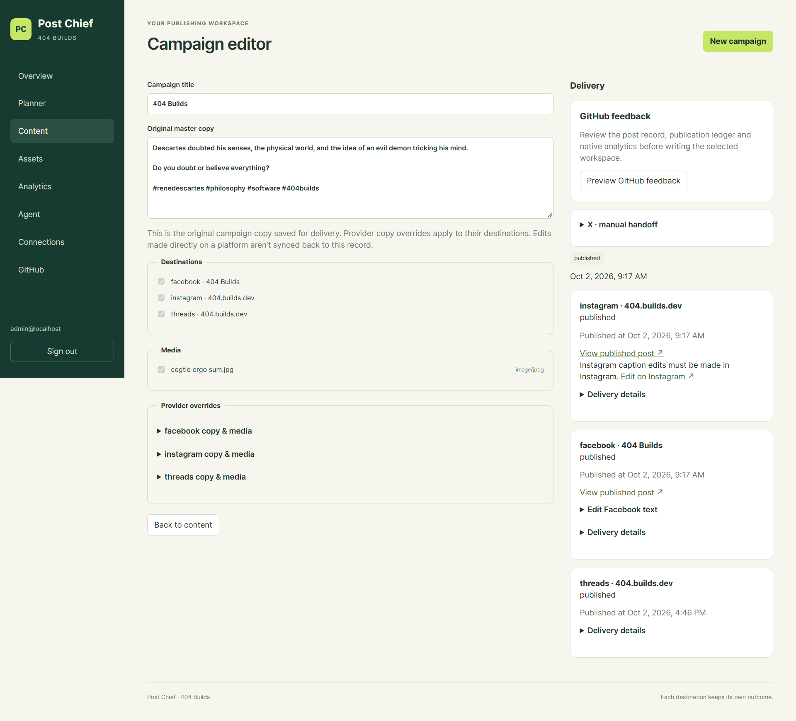
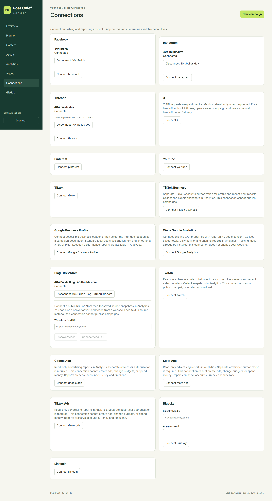

# Post Chief

**Agentic social media to plan, publish, and track your content**

Post Chief is a self-hosted social media platform built for AI agents. Give your
agent a workspace to plan campaigns, prepare content, publish authorized posts,
track results, and maintain a durable content history.

Agents operate through MCP and the API. The dashboard is your control room for
reviewing content, managing connections, setting permissions, and stepping in
when a decision needs you. You can also run the publishing workflow yourself.

Built and used by **404 Builds**. Your deployment, your data, your publishing rules.

*One campaign. Independent results for every destination.*

## Built for AI agents

Connect **ChatGPT or Codex** through OAuth-authenticated MCP. Post Chief exposes
25 tools for reading campaigns, preparing drafts, working with assets and GitHub
content, checking analytics, and requesting delivery.

You decide which actions can run automatically, need approval, or are disabled.
Agents work within their granted permissions, and approvals belong to the owner.
The same rules apply whether an action comes from MCP or the API.

An agent can prepare the next campaign, check the outcome of the last one, and
leave a concise work report. Recurring agent runs are configured in the agent's
host; Post Chief supplies the operational tools and publishing engine.

## From a plan to published results

- **Prepare once, tailor each destination.** Your agent keeps campaign copy and
  assets together, with captions and media suited to each platform.
- **Deliver on your terms.** Save drafts, schedule ahead, or publish when ready,
  within the permissions and approval rules you set.
- **Track each outcome.** Every destination retains its own status, publication
  time, post link when available, and errors. Successful results remain intact
  while a failed destination is addressed.
- **Reuse your media.** Agents can select existing assets or import media from
  authorized GitHub repositories; people can upload through the dashboard.
- **Read the results.** Native metrics and saved account reports give agents
  concrete feedback, with reporting windows and missing data made explicit.
- **Keep durable history.** Reviewed GitHub feedback preserves post records,
  the publication ledger, and analytics for future work.

## A control room for humans

Inspect drafts, browse the planner, review delivery outcomes, and approve specific
actions. Manage connected accounts and decide how much autonomy each agent has.
When a provider requires native completion or an uncertain result needs checking,
the dashboard gives you a place to take over.

## Connect publishing and reporting accounts

| Connection | What Post Chief supports |
|---|---|
| Facebook, Instagram, Threads | Native publishing and post analytics |
| X | Direct API publishing and requested metrics, or a manual caption/media handoff |
| Bluesky, LinkedIn | Native publishing and supported engagement metrics |
| Pinterest | Image Pins on a selected public board and Pin analytics |
| YouTube | Video uploads, processing/visibility checks, and native reporting |
| TikTok | Reviewed inbox upload, with posting completed in TikTok |
| Google Business Profile | Standard local posts and location performance reports |
| TikTok Business, Twitch | Account and channel reporting |
| Google Analytics | Saved GA4 property reports |
| Blog · RSS/Atom | Feed discovery and saved source snapshots for agent context |
| Meta Ads, Google Ads, TikTok Ads | Advertising reports with native dates, currency, and metrics |
| Looker Studio | Private connector for saved reporting data |

Publishing, reporting, and source connections have different capabilities.
Provider permissions, app approvals, media requirements, quotas, and API fees
still apply. Facebook, Instagram, and Threads have been exercised with real
publications; each additional integration needs its own account setup and live
acceptance.

See the Connections dashboard

## Built to be yours

Host Post Chief on infrastructure you control. Provider credentials stay encrypted
on your server, and agent access is scoped and revocable. Review external writes,
inspect action history, and retain your operational database and media backups.

GitHub remains the durable content workspace: selected source repositories are
read-only, while reviewed feedback goes to the designated social workspace.

The stack uses React and TypeScript, FastAPI, PostgreSQL, Redis, and Celery. The
current 404 Builds deployment runs on a 1 GB Oracle VM behind Cloudflare Tunnel,
with both a cloud ChatGPT agent and Codex connected through MCP.

## Get started

**[Read the usage guide](USAGE.md)** for setup, deployment, provider configuration,
dashboard workflows, agent connections, development, and troubleshooting.
